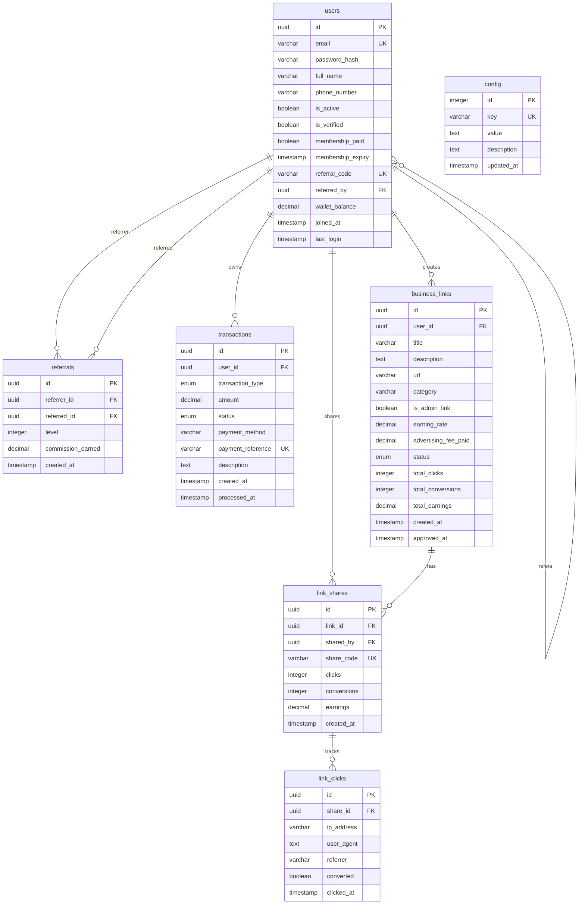

# MIRUCHAIN - Database Schema Design

## Overview

PostgreSQL database schema for the MIRUCHAIN referral-based advertising platform. Uses UUID primary keys for better scalability and security.

## Entity Relationship Diagram



## Table Definitions

### 1. users

Stores all user accounts (members and admins).

```sql
CREATE TABLE users (
    id UUID PRIMARY KEY DEFAULT gen_random_uuid(),
    email VARCHAR(255) NOT NULL UNIQUE,
    password_hash VARCHAR(255) NOT NULL,
    full_name VARCHAR(255) NOT NULL,
    phone_number VARCHAR(20),
    is_active BOOLEAN DEFAULT TRUE,
    is_verified BOOLEAN DEFAULT FALSE,
    is_admin BOOLEAN DEFAULT FALSE,
    membership_paid BOOLEAN DEFAULT FALSE,
    membership_expiry TIMESTAMP,
    referral_code VARCHAR(20) NOT NULL UNIQUE,
    referred_by UUID REFERENCES users(id) ON DELETE SET NULL,
    wallet_balance DECIMAL(10, 2) DEFAULT 0.00,
    joined_at TIMESTAMP DEFAULT CURRENT_TIMESTAMP,
    last_login TIMESTAMP,
    created_at TIMESTAMP DEFAULT CURRENT_TIMESTAMP,
    updated_at TIMESTAMP DEFAULT CURRENT_TIMESTAMP
);

-- Indexes
CREATE INDEX idx_users_email ON users(email);
CREATE INDEX idx_users_referral_code ON users(referral_code);
CREATE INDEX idx_users_referred_by ON users(referred_by);
CREATE INDEX idx_users_membership_paid ON users(membership_paid);
CREATE INDEX idx_users_is_active ON users(is_active);

-- Prevent self-referral
ALTER TABLE users ADD CONSTRAINT chk_no_self_referral 
    CHECK (id != referred_by);
```

**Fields**:
- `id`: UUID primary key
- `email`: Unique email address for login
- `password_hash`: Hashed password (bcrypt/argon2)
- `full_name`: User's full name
- `phone_number`: Optional phone number
- `is_active`: Account status (can be deactivated by admin)
- `is_verified`: Email verification status
- `is_admin`: Admin privileges flag
- `membership_paid`: Whether active membership exists
- `membership_expiry`: When membership expires (if recurring)
- `referral_code`: Unique code for referring others
- `referred_by`: Foreign key to user who referred this user
- `wallet_balance`: Current wallet balance for withdrawals
- `joined_at`: Account creation timestamp
- `last_login`: Last login timestamp

---

### 2. referrals

Tracks all referral relationships and commissions earned.

```sql
CREATE TABLE referrals (
    id UUID PRIMARY KEY DEFAULT gen_random_uuid(),
    referrer_id UUID NOT NULL REFERENCES users(id) ON DELETE CASCADE,
    referred_id UUID NOT NULL REFERENCES users(id) ON DELETE CASCADE,
    level INTEGER NOT NULL,
    commission_earned DECIMAL(10, 2) NOT NULL,
    created_at TIMESTAMP DEFAULT CURRENT_TIMESTAMP
);

-- Indexes
CREATE INDEX idx_referrals_referrer ON referrals(referrer_id);
CREATE INDEX idx_referrals_referred ON referrals(referred_id);
CREATE INDEX idx_referrals_level ON referrals(level);

-- Ensure unique referral relationship per level
CREATE UNIQUE INDEX idx_referrals_unique ON referrals(referrer_id, referred_id, level);
```

**Fields**:
- `id`: UUID primary key
- `referrer_id`: User who earned the commission
- `referred_id`: User who generated the commission (new member)
- `level`: Depth in referral chain (1 = direct, 2+ = upline)
- `commission_earned`: Amount earned from this referral
- `created_at`: When commission was earned

---

### 3. transactions

Records all financial transactions in the system.

```sql
CREATE TYPE transaction_type_enum AS ENUM (
    'membership',
    'advertising',
    'referral_commission',
    'withdrawal',
    'link_earning'
);

CREATE TYPE transaction_status_enum AS ENUM (
    'pending',
    'completed',
    'failed',
    'cancelled'
);

CREATE TABLE transactions (
    id UUID PRIMARY KEY DEFAULT gen_random_uuid(),
    user_id UUID NOT NULL REFERENCES users(id) ON DELETE CASCADE,
    transaction_type transaction_type_enum NOT NULL,
    amount DECIMAL(10, 2) NOT NULL,
    status transaction_status_enum DEFAULT 'pending',
    payment_method VARCHAR(50),
    payment_reference VARCHAR(255) UNIQUE,
    description TEXT,
    metadata JSONB,
    created_at TIMESTAMP DEFAULT CURRENT_TIMESTAMP,
    processed_at TIMESTAMP
);

-- Indexes
CREATE INDEX idx_transactions_user ON transactions(user_id);
CREATE INDEX idx_transactions_type ON transactions(transaction_type);
CREATE INDEX idx_transactions_status ON transactions(status);
CREATE INDEX idx_transactions_created ON transactions(created_at DESC);
CREATE INDEX idx_transactions_reference ON transactions(payment_reference);
```

**Fields**:
- `id`: UUID primary key
- `user_id`: User associated with transaction
- `transaction_type`: Type of transaction
  - `membership`: Membership fee payment
  - `advertising`: Business link advertising fee
  - `referral_commission`: Commission earned from referral
  - `withdrawal`: User withdrawal from wallet
  - `link_earning`: Earnings from link shares
- `amount`: Transaction amount (positive for earnings, negative for payments out)
- `status`: Current status
- `payment_method`: Payment gateway used
- `payment_reference`: External payment ID (for reconciliation)
- `description`: Human-readable description
- `metadata`: Additional data (JSON)
- `created_at`: Transaction creation time
- `processed_at`: When transaction completed

---

### 4. business_links

Stores all business links (user-created and admin promotional).

```sql
CREATE TYPE link_status_enum AS ENUM (
    'pending',
    'approved',
    'rejected',
    'active',
    'inactive'
);

CREATE TABLE business_links (
    id UUID PRIMARY KEY DEFAULT gen_random_uuid(),
    user_id UUID REFERENCES users(id) ON DELETE SET NULL,
    title VARCHAR(255) NOT NULL,
    description TEXT,
    url TEXT NOT NULL,
    category VARCHAR(100),
    is_admin_link BOOLEAN DEFAULT FALSE,
    earning_rate DECIMAL(10, 2) DEFAULT 0.00,
    advertising_fee_paid DECIMAL(10, 2) DEFAULT 0.00,
    status link_status_enum DEFAULT 'pending',
    total_clicks INTEGER DEFAULT 0,
    total_conversions INTEGER DEFAULT 0,
    total_earnings DECIMAL(10, 2) DEFAULT 0.00,
    created_at TIMESTAMP DEFAULT CURRENT_TIMESTAMP,
    approved_at TIMESTAMP,
    updated_at TIMESTAMP DEFAULT CURRENT_TIMESTAMP
);

-- Indexes
CREATE INDEX idx_links_user ON business_links(user_id);
CREATE INDEX idx_links_status ON business_links(status);
CREATE INDEX idx_links_category ON business_links(category);
CREATE INDEX idx_links_admin ON business_links(is_admin_link);
CREATE INDEX idx_links_created ON business_links(created_at DESC);
```

**Fields**:
- `id`: UUID primary key
- `user_id`: User who created the link (NULL for admin links)
- `title`: Link title/name
- `description`: Link description
- `url`: Actual URL to promote
- `category`: Category for filtering
- `is_admin_link`: Whether this is an admin promotional link
- `earning_rate`: For admin links, earning per share/conversion
- `advertising_fee_paid`: Fee paid to advertise this link
- `status`: Moderation status
- `total_clicks`: Total clicks across all shares
- `total_conversions`: Total conversions
- `total_earnings`: Total earnings generated by this link
- `created_at`: Link creation time
- `approved_at`: When admin approved

---

### 5. link_shares

Tracks individual user shares of business links with unique codes.

```sql
CREATE TABLE link_shares (
    id UUID PRIMARY KEY DEFAULT gen_random_uuid(),
    link_id UUID NOT NULL REFERENCES business_links(id) ON DELETE CASCADE,
    shared_by UUID NOT NULL REFERENCES users(id) ON DELETE CASCADE,
    share_code VARCHAR(50) NOT NULL UNIQUE,
    clicks INTEGER DEFAULT 0,
    conversions INTEGER DEFAULT 0,
    earnings DECIMAL(10, 2) DEFAULT 0.00,
    created_at TIMESTAMP DEFAULT CURRENT_TIMESTAMP,
    last_clicked_at TIMESTAMP
);

-- Indexes
CREATE INDEX idx_link_shares_link ON link_shares(link_id);
CREATE INDEX idx_link_shares_user ON link_shares(shared_by);
CREATE INDEX idx_link_shares_code ON link_shares(share_code);

-- Ensure unique share per user per link
CREATE UNIQUE INDEX idx_link_shares_unique ON link_shares(link_id, shared_by);
```

**Fields**:
- `id`: UUID primary key
- `link_id`: Business link being shared
- `shared_by`: User sharing the link
- `share_code`: Unique tracking code for this share
- `clicks`: Number of clicks on this share
- `conversions`: Number of conversions from this share
- `earnings`: Total earnings from this share
- `created_at`: When share was created
- `last_clicked_at`: Last click timestamp

---

### 6. link_clicks

Detailed analytics for each link click.

```sql
CREATE TABLE link_clicks (
    id UUID PRIMARY KEY DEFAULT gen_random_uuid(),
    share_id UUID NOT NULL REFERENCES link_shares(id) ON DELETE CASCADE,
    ip_address VARCHAR(45),
    user_agent TEXT,
    referrer VARCHAR(500),
    converted BOOLEAN DEFAULT FALSE,
    clicked_at TIMESTAMP DEFAULT CURRENT_TIMESTAMP
);

-- Indexes
CREATE INDEX idx_link_clicks_share ON link_clicks(share_id);
CREATE INDEX idx_link_clicks_ip ON link_clicks(ip_address);
CREATE INDEX idx_link_clicks_clicked ON link_clicks(clicked_at DESC);
CREATE INDEX idx_link_clicks_converted ON link_clicks(converted);
```

**Fields**:
- `id`: UUID primary key
- `share_id`: Link share that was clicked
- `ip_address`: Visitor's IP address
- `user_agent`: Browser user agent
- `referrer`: HTTP referrer
- `converted`: Whether this click led to a conversion
- `clicked_at`: Click timestamp

---

### 7. config

Stores platform configuration settings.

```sql
CREATE TABLE config (
    id SERIAL PRIMARY KEY,
    key VARCHAR(100) NOT NULL UNIQUE,
    value TEXT NOT NULL,
    description TEXT,
    updated_at TIMESTAMP DEFAULT CURRENT_TIMESTAMP
);

-- Initial configuration
INSERT INTO config (key, value, description) VALUES
    ('membership_fee', '100.00', 'Membership fee amount in USD'),
    ('advertising_fee', '10.00', 'Fee to post a business link'),
    ('direct_commission_rate', '0.25', 'Direct referral commission rate (25%)'),
    ('upline_pool_rate', '0.25', 'Upline commission pool rate (25%)'),
    ('upline_split_rate', '0.50', 'Upline commission split rate (50%)'),
    ('minimum_withdrawal', '10.00', 'Minimum withdrawal amount'),
    ('withdrawal_fee', '0.00', 'Withdrawal processing fee');
```

**Fields**:
- `id`: Auto-increment primary key
- `key`: Configuration key (unique)
- `value`: Configuration value (stored as text)
- `description`: Human-readable description
- `updated_at`: Last update timestamp

---

## Views for Common Queries

### User Dashboard Stats

```sql
CREATE VIEW user_dashboard_stats AS
SELECT 
    u.id AS user_id,
    u.full_name,
    u.email,
    u.wallet_balance,
    COUNT(DISTINCT r1.referred_id) AS total_direct_referrals,
    COUNT(DISTINCT r2.referred_id) AS total_all_referrals,
    COALESCE(SUM(r1.commission_earned), 0) AS direct_commissions,
    COALESCE(SUM(r2.commission_earned), 0) AS total_commissions,
    COUNT(DISTINCT bl.id) AS total_links_posted,
    COUNT(DISTINCT ls.id) AS total_shares,
    COALESCE(SUM(ls.earnings), 0) AS link_earnings
FROM users u
LEFT JOIN referrals r1 ON u.id = r1.referrer_id AND r1.level = 1
LEFT JOIN referrals r2 ON u.id = r2.referrer_id
LEFT JOIN business_links bl ON u.id = bl.user_id
LEFT JOIN link_shares ls ON u.id = ls.shared_by
GROUP BY u.id;
```

### Admin Analytics

```sql
CREATE VIEW admin_analytics AS
SELECT 
    COUNT(DISTINCT CASE WHEN membership_paid THEN id END) AS active_members,
    COUNT(DISTINCT id) AS total_users,
    COALESCE(SUM(CASE WHEN transaction_type = 'membership' AND status = 'completed' 
        THEN amount END), 0) AS membership_revenue,
    COALESCE(SUM(CASE WHEN transaction_type = 'advertising' AND status = 'completed' 
        THEN amount END), 0) AS advertising_revenue,
    COALESCE(SUM(CASE WHEN transaction_type = 'withdrawal' AND status = 'completed' 
        THEN amount END), 0) AS total_withdrawals,
    COUNT(DISTINCT CASE WHEN bl.status = 'pending' THEN bl.id END) AS pending_links
FROM users u
CROSS JOIN transactions t
CROSS JOIN business_links bl;
```

## Migrations

### Django Migration Example

```python
# Generated by Django
from django.db import migrations, models
import uuid

class Migration(migrations.Migration):
    
    initial = True
    
    dependencies = []
    
    operations = [
        migrations.CreateModel(
            name='User',
            fields=[
                ('id', models.UUIDField(default=uuid.uuid4, editable=False, primary_key=True)),
                ('email', models.EmailField(max_length=255, unique=True)),
                ('password_hash', models.CharField(max_length=255)),
                ('full_name', models.CharField(max_length=255)),
                # ... other fields
            ],
        ),
        # ... other models
    ]
```

## Sample Queries

### Get User's Referral Tree (3 levels deep)

```sql
WITH RECURSIVE referral_tree AS (
    -- Base case: direct referrals
    SELECT 
        id,
        full_name,
        email,
        referral_code,
        1 AS level
    FROM users
    WHERE referred_by = 'target-user-uuid'
    
    UNION ALL
    
    -- Recursive case: referrals of referrals
    SELECT 
        u.id,
        u.full_name,
        u.email,
        u.referral_code,
        rt.level + 1
    FROM users u
    INNER JOIN referral_tree rt ON u.referred_by = rt.id
    WHERE rt.level < 3
)
SELECT * FROM referral_tree ORDER BY level, full_name;
```

### Get Top Earners

```sql
SELECT 
    u.full_name,
    u.email,
    COALESCE(SUM(r.commission_earned), 0) + 
    COALESCE(SUM(ls.earnings), 0) AS total_earnings
FROM users u
LEFT JOIN referrals r ON u.id = r.referrer_id
LEFT JOIN link_shares ls ON u.id = ls.shared_by
GROUP BY u.id
ORDER BY total_earnings DESC
LIMIT 10;
```

### Get Link Performance

```sql
SELECT 
    bl.title,
    bl.category,
    COUNT(DISTINCT ls.id) AS total_shares,
    SUM(ls.clicks) AS total_clicks,
    SUM(ls.conversions) AS total_conversions,
    CASE 
        WHEN SUM(ls.clicks) > 0 
        THEN ROUND(100.0 * SUM(ls.conversions) / SUM(ls.clicks), 2)
        ELSE 0
    END AS conversion_rate
FROM business_links bl
LEFT JOIN link_shares ls ON bl.id = ls.link_id
WHERE bl.status = 'approved'
GROUP BY bl.id
ORDER BY total_clicks DESC;
```

## Backup & Maintenance

### Regular Backups

```bash
# Daily backup
pg_dump -U miruchain_user -d miruchain_db > backup_$(date +%Y%m%d).sql

# Compressed backup
pg_dump -U miruchain_user -d miruchain_db | gzip > backup_$(date +%Y%m%d).sql.gz
```

### Data Retention

- Keep transaction records indefinitely (regulatory requirement)
- Archive link_clicks older than 1 year
- Purge failed transactions after 90 days
- Keep referral records indefinitely

## Performance Optimization

1. **Indexes**: Already defined for common query patterns
2. **Partitioning**: Consider partitioning `link_clicks` by month for large datasets
3. **Materialized Views**: Cache dashboard stats for admin panel
4. **Connection Pooling**: Use PgBouncer for connection management
5. **Query Optimization**: Use EXPLAIN ANALYZE for slow queries
